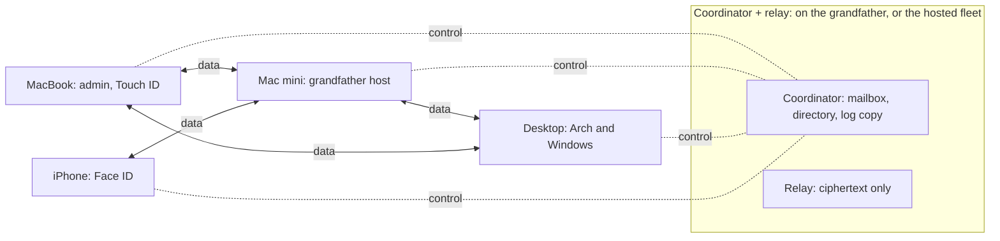

# OpenVault design

Status: draft, 2026-11-04
Repos: `Abyssinia-Labs/openvault` (public), `Abyssinia-Labs/openvault-apple` and `Abyssinia-Labs/openvault-cloud` (private)

## 1. Why

Secrets, variables and private files stay on the machine they were created on. Moving latem-cloud's Android build to the desktop failed because the desktop had none of the variables, secrets or signing files, and there was no safe way to bring them over from machines on the same network. Moving to a new laptop runs into the same problem. Password managers aren't built for environment variables or files, and the hosted alternatives either cost money or ask you to trust a third party with the data.

OpenVault keeps secrets, variables and files encrypted on your own devices. A device you enroll gets exactly the collections it is scoped to. Your devices reach each other on the LAN and over the internet, and nothing you own is stored on a server.

## 2. Goals and non-goals

Goals:

- One encrypted vault per person, holding secrets, variables and files, organized into collections.
- A new device joins with one approval on an admin device and receives only the collections it is scoped to.
- Devices reach each other on the LAN and over the internet without storing user data in the cloud.
- Losing any device, the admin included, loses nothing: the recovery key restores everything from any remaining copy.
- A compromised device can read only what it was scoped to, and everything it writes is signed and reversible.
- Fully self-hostable. The hosted product sells reachability and convenience, not storage.

Not in v1:

- Sharing between different people. One vault has one owner.
- Remote access to anything outside the vault (SSH, arbitrary folders, remote desktop).
- A server-hosted web app that decrypts the vault in a browser.
- Android, and native Linux or Windows apps. The local web UI covers Linux and Windows.

## 3. Terms

| Term | Meaning |
| --- | --- |
| Vault | Everything one person keeps in OpenVault: one membership log and its collections. |
| Collection | The unit of scope and encryption, such as `latem-cloud`, `ssh` or `documents`. Has its own key. |
| Entry | A secret, a variable or a file inside a collection. |
| Device | One OS install with its own keys. A dual-boot desktop is two devices. |
| Admin | A key allowed to change membership and scopes: the MacBook's Secure Enclave admin key (Touch ID) and the recovery key. |
| Scope | What a device may do with a collection: `none`, `hold` (store ciphertext only), `read` or `write`. |
| Placement | Whether a device keeps a full copy of a collection or fetches on demand. |
| Membership log | Append-only, hash-chained, admin-signed record of devices, their public keys, scopes and revocations. |
| Coordinator | Mailbox, device directory and copy of the membership log. Untrusted. |
| Relay | Forwards encrypted traffic between devices that can't connect directly. Untrusted. |
| Grandfather | The always-on device that runs the coordinator and relay, and holds `hold` copies. Chosen in config: the Mac mini, or a Linux or Windows desktop. |

## 4. Trust model

### Invariants

- **OV-1.** Plaintext and collection keys exist only on devices with `read` or `write` scope on that collection. The coordinator, relays, `hold` devices and the hosted service handle ciphertext only.
- **OV-2.** The coordinator is untrusted. It can delay, drop or replay messages. It cannot add a device, change a scope or read data.
- **OV-3.** Only admins change membership and scopes. A device accepts a log entry only if it extends the hash chain it already has and carries a valid admin signature.
- **OV-4.** Every write is signed by the device that made it and kept in history.
- **OV-5.** Data at rest is always encrypted. A device serving data sends the ciphertext as stored; only the reading device decrypts.
- **OV-6.** No user data passes through Convex. In the hosted product, Convex holds accounts, billing and plan limits only.
- **OV-7.** Every device-to-device connection is authenticated with device keys, and each side checks the other against the membership log before exchanging data.

### Adversaries

| Adversary | Can | Cannot |
| --- | --- | --- |
| Lost or stolen device, locked | Keep the encrypted store | Decrypt without the hardware key and an unlock; keep syncing after it is revoked |
| Compromised device (attacker running code as you) | Read collections it has `read` or `write` on while it controls the device; write where it has `write`, signed and reversible | Enroll devices, widen its own scope, use the admin key, read other collections |
| Compromised coordinator or hosted service | See device public keys, IP addresses, timing, collection counts and sizes; block joins; delay messages | Read data; insert its own key into a join; forge log entries |
| Relay operator or network attacker | See IP addresses, timing and volume | Read or change traffic |

### Known limits

- A compromised device reads what it is scoped to while it is compromised. Revoking it stops future access but can't take back what was read, so OpenVault lists the secrets to rotate at their providers.
- While an app has a file open, the file is plaintext in that app's memory, and often in its autosave or temp files.
- WSL can't reach a TPM or Windows Hello, so its keys are files. Scope it narrowly.
- An attacker controlling the MacBook can try to get a malicious change signed the next time you press Touch ID. Admin prompts show exactly what is being signed; an unexpected prompt is an incident.

## 5. Architecture



Control messages (joins, approvals, the device directory, the membership log) go through the coordinator. Data (secrets, variables, files) goes device to device over iroh: directly when possible, otherwise through the relay as ciphertext.

On each device:

- **Service** (`openvault service`) owns the encrypted store, the keys and sync. It exposes a local API on a Unix socket (a named pipe on Windows) and serves the web UI on `localhost`.
- **CLI** (`openvault`) is a client of the service.
- **Apps.** The macOS app bundles the service as a LaunchAgent. The iOS app runs the core in-process, because iOS won't keep a background service running.
- **Grandfather** (`openvault grandfather`) runs the coordinator, the relay and `hold` storage. It is designed to run in Docker.

## 6. Data model

**Collection.** A random `collection_id`, an encrypted name, the current key epoch, and its entries. Each epoch has a random 256-bit collection key, wrapped once for each device with `read` or `write` scope and once for the recovery key.

**Record.** Entries are stored as immutable, signed records. Each record has two parts:

- A cleartext header, so devices with `hold` scope can sync without decrypting: `record_id`, `collection_id`, key epoch, version (Lamport clock plus device id), author device, signature, ciphertext hash and a deleted flag.
- An encrypted body: kind (`secret`, `var` or `file`), name, value or file manifest, and metadata.

Entry names are paths within the collection, for example `prod/SENTRY_DSN` or `release/upload.jks`.

**File manifest.** Size, modification time, the list of chunk hashes, and a per-file key wrapped by the collection key. Files are split into fixed 1 MiB chunks. Each chunk is encrypted with the file key using a nonce derived from the chunk index and file version, and is addressed by the BLAKE3 hash of its ciphertext.

**Device record** (in the membership log). Device id, display name, platform, public keys (see §7), scopes, who enrolled it, and its status. The name and platform are sealed with the vault's names key, so the coordinator's copy of the log doesn't show them ([membership.md](spec/membership.md#names-key)).

**Scope** is set per device and collection by an admin and recorded in the log. **Placement** is a local preference that each device advertises so others know where to fetch from.

## 7. Cryptography

Only audited libraries; no custom primitives. There are two exceptions, because no Rust crate for either has been audited: the PAKE uses RustCrypto's `spake2` ([join.md](spec/join.md#pake)), and passphrases use RustCrypto's `argon2` ([crypto.md](spec/crypto.md#passphrases)). The external audit covers both.

| Purpose | Primitive |
| --- | --- |
| Signing writes and log entries | ECDSA P-256 for Secure Enclave and TPM keys; Ed25519 for file keys |
| Wrapping collection keys | HPKE (RFC 9180): DHKEM(P-256) for Secure Enclave and TPM keys, DHKEM(X25519) for file keys |
| Records and chunks | XChaCha20-Poly1305 |
| Hashing and content addressing | BLAKE3 |
| Pairing | SPAKE2 keyed by a 6-digit code |
| Key files protected by a passphrase | Argon2id |
| Secrets in memory | `zeroize` and `secrecy` types |

### Device keys

| Key | Where it lives | Used for |
| --- | --- | --- |
| Transport (Ed25519) | Keychain, or a 0600 file | iroh node identity; connection authentication |
| Wrapping | Secure Enclave or TPM (P-256); otherwise a file (X25519) | Unwrapping collection keys |
| Signing | Secure Enclave or TPM (P-256); otherwise a file (Ed25519) | Signing writes |
| Admin (MacBook only) | Secure Enclave, with Touch ID required on every use | Signing membership log entries |

The Secure Enclave can't hold Ed25519 keys, so the transport key is a software key. Anyone who copies it can appear to be the device on the network, but can't decrypt or sign anything, and connecting still requires a current log entry.

### Recovery key

A 256-bit random secret, shown once as 24 words and kept offline (paper or the Passwords app). It derives an admin signing key and a wrapping key, and every collection key is also wrapped to it. With it you can enroll a new admin, revoke devices, and restore every collection from any surviving copy. A hardware security key (WebAuthn PRF / `hmac-secret`) can be added later as an alternative recovery factor.

### Membership log

Entry types: `genesis`, `add_device`, `set_scope`, `revoke_device`, `rotate_epoch`, `add_admin`, `remove_admin`. Each entry carries the previous entry's hash, a sequence number, its payload and an admin signature.

The coordinator distributes the log, and devices also exchange it directly, so a hidden revocation still spreads. Two valid entries with the same sequence number mean a fork: devices raise an alert and stop syncing until an admin resolves it.

### Revocation

1. An admin signs `revoke_device`. Every device that sees it stops serving and accepting connections from the revoked device.
2. Each collection the device could read moves to a new key epoch, and new writes use the new key.
3. Versions the revoked device signed under old epochs stop counting, so nothing it signs with its old keys can become current. The remaining writers rewrite the entries it had last written, so its real changes are kept ([sync.md](spec/sync.md#revoking-and-reducing-scopes)). Nothing else is re-encrypted, since the device has already read it; file chunks are re-encrypted only on request (see §19).
4. OpenVault lists every secret the revoked device could read, so you can rotate them at their providers.

## 8. Joining

1. On the new device, `openvault join` (or the app) creates its keys, in hardware where available, and shows a 6-digit code.
2. On the MacBook, a notification or `openvault approve` asks for the code. The two devices run the PAKE through the coordinator's mailbox, or directly on the LAN when there is no coordinator. Inside the channel the PAKE authenticates, the new device sends its public keys and the MacBook sends the vault's genesis hash, so a coordinator can't substitute either one.
3. The MacBook shows the device's name, platform and proposed scopes. After Touch ID, it signs `add_device` and the scope entries and wraps the keys for the device's collections.
4. The new device verifies the log from genesis, receives its wrapped keys through the mailbox, and pulls its data from other devices over iroh.

Codes expire after 10 minutes, and three wrong codes cancel the request. A self-hosted setup without a coordinator uses the same flow over a direct LAN connection.

## 9. Sync

- **Reconciliation.** For each collection, peers compare a root hash of their record sets. If the hashes match, they're done. Otherwise they find the missing records with range-based set reconciliation.
- **Triggers.** Sync runs on a local write, when a peer connects, or when the membership changes. There are no periodic full scans; idle peers exchange root hashes only.
- **Conflicts.** Records are immutable versions. The latest version by (Lamport clock, device id) is shown and older versions stay in history. Saving a file that was edited from an older version creates a conflict copy instead of overwriting.
- **Serving.** A device serves a collection's ciphertext only to peers whose current log entry gives them `hold`, `read` or `write` on it.
- **Chunks.** Fetched with iroh-blobs using BLAKE3 verified streaming, so previews can start before the download finishes. Chunks come from the nearest holder, and range requests are supported.
- **History.** Each collection keeps N versions or D days, configurable. Deletes are tombstones. Chunks nothing references any more are garbage-collected.

## 10. Networking

- Each device runs one iroh endpoint. Its node id is the transport public key.
- Devices find each other with mDNS on the LAN and through the coordinator's directory (node id and home relay, written only when they change).
- Connections try a direct LAN path, then a direct internet path via hole punching, then the relay.
- **Relay options:**
  - The grandfather. It needs a forwarded port and a hostname (dynamic DNS) for reachability from outside your home.
  - The hosted fleet.
  - n0's public relays, for development only.

## 11. Coordinator

**Jobs:**

- **Mailbox:** join requests, PAKE messages, wrapped keys and approval requests. Join messages expire after 10 minutes and everything else after 7 days, so the mailbox stays bounded.
- **Directory:** node id and home relay for each device, written only on change.
- **Log copy:** stores the membership log and serves entries after a given sequence number, a page at a time.
- **Push relay (hosted only):** sends content-free APNs wake-ups to iOS devices. It holds the APNs key, which is why self-hosted setups either use the hosted push relay or skip push.

**Storage:** SQLite. Every table is indexed by vault plus sequence number or expiry, and every read is bounded.

**Modes:**

- **Single-tenant (grandfather):** one vault, no accounts.
- **Multi-tenant (hosted):** many vaults. Devices present an enrollment token, a JWT signed by `openvault-cloud` and verified offline against its JWKS, carrying the account, vault and plan limits. Presence is kept in memory, never written to Convex.

## 12. Platforms

| Platform | Ships as | Keys | Unlock | Files |
| --- | --- | --- | --- | --- |
| macOS | App that bundles the service, plus the CLI | Secure Enclave | Touch ID | File Provider (Finder) |
| iOS | App with the core in-process | Secure Enclave | Face ID | File Provider (Files app) |
| Linux | Service, CLI, local web UI | TPM if present, otherwise a file | TPM PIN or passphrase | CLI; FUSE mount later |
| Windows | Service, CLI, local web UI; native app later | File at first; TPM / Windows Hello later | Passphrase | CLI |
| WSL | Service and CLI | File | Passphrase | CLI |
| Docker | `grandfather` mode (no keys); `device` mode (file key, UI on localhost only) | None, or a file | — | — |

For the current machines:

- **MacBook:** admin.
- **Mac mini:** grandfather in OrbStack, plus a native device install for the collections it uses itself, such as latem's.
- **Desktop (Arch) and desktop (Windows / WSL):** two separate devices with narrow scopes.

## 13. Files

- Files are always encrypted at rest. There is no plaintext mirror mode.
- **Import:** `openvault import <folder> --collection <name>` encrypts a folder into the store. It requires full-disk encryption on the importing device (FileVault, LUKS or BitLocker), because the original plaintext may survive on the SSD after deletion.
- **Open:**
  - `openvault open <collection>/<path>` decrypts the file to a private temporary location and opens it in its app. It re-encrypts on save and deletes the temporary copy on close.
  - `openvault get` writes a file to stdout or to a path you name.
  - Apple platforms use File Provider; Linux gets a FUSE mount later.
- **Placement:** keep a copy, or fetch on demand from the nearest holder.
- **Phone cache:** files stay in the app sandbox with `NSFileProtectionComplete`, expire per collection, and are wiped on the first launch after the phone is revoked.

## 14. Interfaces

```
openvault init                                  create a vault; this device becomes admin; shows the recovery key
openvault join                                  on a new device: create keys, show a code
openvault approve                               on an admin: enter the code, review, Touch ID
openvault devices [revoke <device>]
openvault scope <device> <collection> none|hold|read|write
openvault collections [create <name>]
openvault set <collection>/<name> --secret|--var    value read from stdin
openvault get <collection>/<name>
openvault list <collection>[/<folder>]          names and kinds, never values
openvault delete <collection>/<name>
openvault run --collection <c> --env <e> [--prefix <p>] -- <command>   variables and secrets as env; files as temporary paths
openvault import-env <file> --collection <c> --env <e> [--var <name>]...   a NAME=value file, such as latem's secrets.env
openvault import <folder> --collection <c>
openvault open <collection>/<path>
openvault service
openvault grandfather
```

The local API runs on a Unix socket or named pipe for the CLI and apps, and on `localhost` HTTP for the web UI. The web UI needs a per-session token and checks the `Host` and `Origin` headers, since any website you visit can send requests to `localhost`.

## 15. latem integration

To confirm with the latem session.

- latem adds an `openvault` secret store next to `keychain` and `file`.
- **Mapping:**
  - One collection per repo.
  - Entries named `<env>/<NAME>`, of kind `var` or `secret`.
  - Files (signing keystores, `google-services.json`, service-account JSON) are written to a temporary path for the length of the job, exposed through an environment variable, and deleted afterward.
- **Variables come from OpenVault,** so every machine sees the same values and amendment A68's mismatches disappear.
- **latem-cloud keeps INV-2.** It still sees only names, and can show "machine X lacks collection Y" by name.
- **Onboarding.** latem's first-run "copy from which machine?" becomes `openvault join` plus scope approval.
- **Until then:** `latem secrets copy --to HOST` remains the stopgap until milestone M2 ships.
- **From M1,** latem can take its secrets from OpenVault without a new store. Bring them in with `openvault import-env ~/.latem/secrets.env --collection latem --env <e>`, then start latem with `openvault run --collection latem --env <e> --prefix LATEM_SECRET_ -- latem …`. latem's environment provider reads `LATEM_SECRET_<NAME>` before its other stores.

## 16. Repositories and stack

Three repos under Abyssinia-Labs.

### `openvault` (public, Apache-2.0 OR MIT)

```
openvault/
  Cargo.toml                 Rust workspace
  crates/
    crypto/                  encryption, signatures, PAKE; audited libraries only
    core/                    collections, records, membership log, scopes, local store (SQLite)
    keystore/                Secure Enclave, TPM, Windows Hello, file fallback
    net/                     iroh endpoint, sync protocol, chunk transfer (iroh-blobs)
    service/                 background service: local API, serves the web UI
    coordinator/             mailbox, directory, log copy, push relay; single- and multi-tenant
    ffi/                     UniFFI bindings (Swift now, Kotlin later)
    cli/                     the `openvault` binary: CLI, `service`, `grandfather`
  web/                       local web UI: TanStack Router SPA, Tailwind 4, shadcn on Base UI, Biome
  docker/                    one image with grandfather and device modes; compose example
  tests/                     several devices, a coordinator and a relay in one process
  docs/                      threat model, protocol spec, ADRs, self-hosting guide
  SECURITY.md
```

- Crypto gets its own crate so an auditor has one place to read.
- `web/` builds to static files that are embedded in the binary, so nothing loads the UI from a server.
- The hosted product runs this same coordinator in multi-tenant mode, so there is no closed Rust code.

### `openvault-apple` (private)

```
openvault-apple/
  project.yml                XcodeGen spec; no hand-edited .pbxproj
  Packages/OpenVaultKit/     binaryTarget pinned to an openvault release (XCFramework + checksum),
                             the UniFFI Swift bindings for that release, models, shared SwiftUI views
  macOS/
    App/
    FileProvider/
    Service/                 LaunchAgent; bundles the Rust service binary
  iOS/
    App/
    FileProvider/
  Tests/
  .github/workflows/         TestFlight, notarization
```

- `OpenVaultKit` gives both apps one Swift API, backed by the bundled service on macOS and by the in-process core on iOS.
- The Mac app ships directly, signed with Developer ID and notarized. iOS ships through TestFlight and the App Store.

### `openvault-cloud` (private, from `start-convex-template`)

```
openvault-cloud/
  packages/web/
    src/routes/              marketing, passkey sign-in, dashboard (devices, plan, relays), billing
    convex/                  accounts, subscriptions, plan limits, enrollment tokens
  infra/fleet/               hosted coordinator and relay regions, pinned to an openvault release
  docs/                      PRD, ADRs, runbook
  .github/workflows/         the template's checks and deploys, plus fleet deploys
```

Changes from the template:

- Remove the R2 component. Nothing user-owned is stored in the cloud.
- Sign in with passkeys (Better Auth's passkey plugin); Google stays optional. The account never unlocks data.
- Convex holds accounts, subscriptions, plan limits and enrollment tokens only (OV-6).
- Device presence lives in the coordinator. The dashboard asks the coordinator when it is opened.
- `infra/fleet/` runs the public Docker image on VMs that support UDP, because Workers can't hold the long-lived connections relays need.

### Releases

1. Tag a release of `openvault`.
2. CI publishes the binaries (macOS, Linux and Windows), the Docker image to GHCR, and the XCFramework with its Swift bindings as release assets.
3. `openvault-apple` and `openvault-cloud` each update their pin in a PR.

The device protocol carries a version number, so one coordinator can serve devices on different releases.

## 17. Cost

Estimates to check against real usage once there is any:

- **Coordinator:** a handful of directory writes per device per day (network changes), log reads only after a change, and mailbox traffic only during joins. Mailbox expiry keeps the SQLite file bounded.
- **Relay:** the variable cost, equal to the bytes of connections that can't go direct.
- **Device to device:** idle peers exchange root hashes only: bytes per minute per pair.

What to watch: relay egress; coordinator database size (a growing file means mailbox expiry isn't working).

The hosted product's plans and running costs are documented in `openvault-cloud`.

## 18. Milestones

| Milestone | Delivers | Done when |
| --- | --- | --- |
| M0 Spec | Threat model, protocol spec, ADRs for §19 | Crypto and wire formats are written down |
| M1 One device | Store, collections, secrets and variables, CLI, `openvault run`, Secure Enclave and file keystores | `~/.latem/secrets.env` can be replaced on the MacBook |
| M2 LAN | PAKE join without a coordinator, membership log, admin Touch ID, recovery key, peer sync over iroh, latem store | The Android build runs on the desktop with secrets from the MacBook |

**Progress.** M1 was done on 2026-11-07. The MacBook's vault took latem's secrets from the mini, streamed over ssh into `openvault import-env -`, because latem's `secrets.env` files are on the mini and the desktop, not the MacBook. Moving those two machines off `secrets.env` comes with M2's sync. The membership log, admin Touch ID and recovery key from M2 were built during M1. On 2026-11-08 the desktop joined the MacBook's vault with a 6-digit code and synced latem's secrets over the LAN. Revoking a device followed the same day. What's left of M2 is latem's store.
| M3 Grandfather | Coordinator, relay, `hold` storage, Docker image | The MacBook reaches the mini from outside the house |
| M4 Files | Chunked encrypted files, import, `open` and `get`, on-demand fetch, local web UI | A signing keystore and a documents folder sync and open on every device |
| M5 Apple apps | macOS app with File Provider; iOS app with Face ID approvals | Joins are approved from a notification |
| M6 Hosted | `openvault-cloud`, multi-tenant coordinator, fleet, billing, push relay | A new user enrolls two devices with no port forwarding |

Later: native Windows, Android, a Linux FUSE mount, a hardware security key for recovery, and an external security audit before the hosted launch.

## 19. Open decisions

1. **Key wrapping: HPKE or age.** Decided: HPKE, one standard that covers P-256 (Secure Enclave, TPM) and X25519. age would need `age-plugin-se` for the Secure Enclave. See [ADR 0001](adr/0001-hpke-key-wrapping.md).
2. **Re-encryption on revoke.** Proposed in [sync.md](spec/sync.md#revoking-and-reducing-scopes): no blanket re-encryption, since it wouldn't hide anything the revoked device has already read.
   - The new epoch protects what is written from then on.
   - Old-epoch versions by a device that has lost `write` stop counting.
   - The remaining writers rewrite only the entries that device wrote last, so its real changes are kept.
   - File chunks are re-encrypted only on request.
3. **Chunking: fixed size or content-defined.** Content-defined chunking deduplicates better but reveals more about file contents. I recommend fixed 1 MiB chunks.
4. **Name.** `openvault` and the `openvault-*` names are free on GitHub (Abyssinia-Labs) and crates.io. Small GitHub projects already use "OpenVault" (one is a password manager and file locker), and it is also the name of a broadband data company. Check the trademark before the hosted launch.
